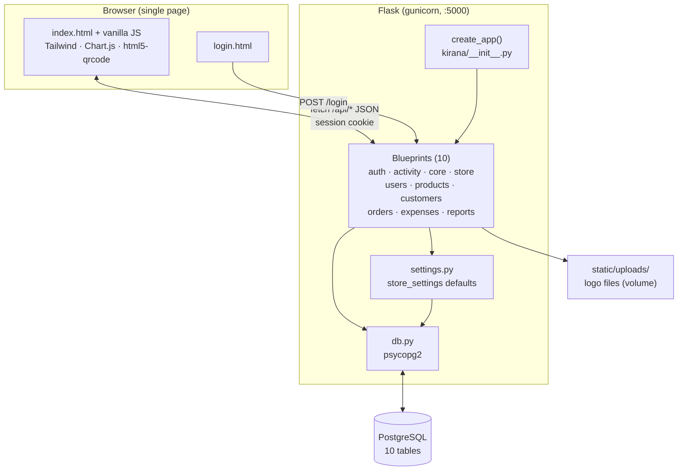
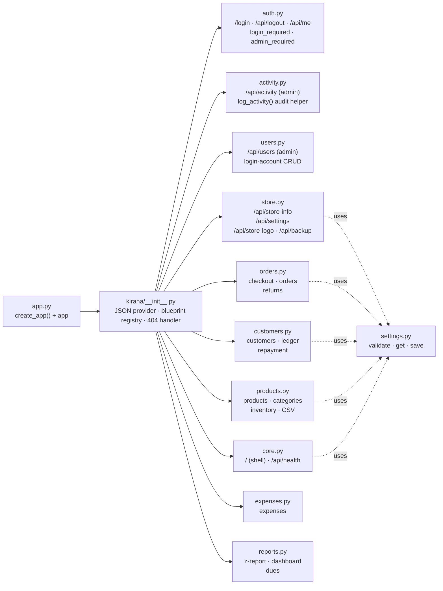
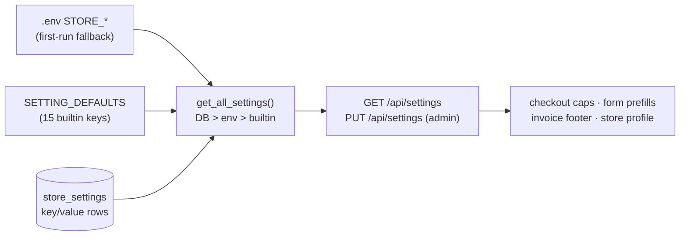
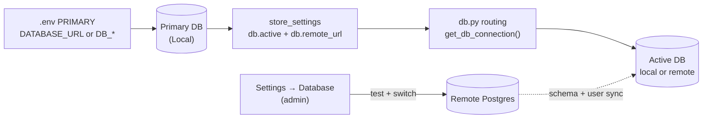
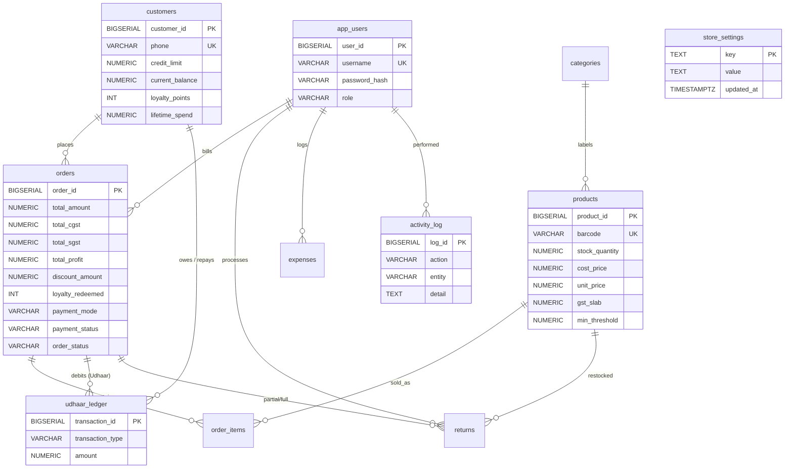

# KiranaPro — Architecture

## 1. System overview



- **Frontend:** server-rendered shell (`GET /` injects store name/location/logo via
  Jinja), then a vanilla-JS SPA — sections toggled client-side, all data via
  `fetch` to `/api/*`. No build step; CDN libs (Tailwind, Chart.js, html5-qrcode).
- **Backend:** Flask 3 app factory (`kirana/__init__.py`), one blueprint module per
  domain, shared `db.py` (psycopg2 + `RealDictCursor`; `DATABASE_URL` or `DB_*`
  vars plus optional `DB_SSLMODE`, with runtime Local/Remote selection via a
  pointer in the primary DB) and `utils.py` (validation, pagination, money formatting).
- **Deploy:** `docker-entrypoint.sh` waits for Postgres → applies `init_db.sql`
  (idempotent) → `seed.py` (idempotent demo users/customers/categories) →
  gunicorn `app:app` (2 workers). Logo uploads persist via named volume on
  `/app/static/uploads`. `docker-compose.yml` provides a one-command local
   stack (app + Postgres).

## 2. Backend modules



| Module | Routes | Guard |
|---|---|---|
| `auth.py` | `GET/POST /login`, `POST /api/logout`, `GET /api/me` | session cookie, Werkzeug hash |
| `activity.py` | `GET /api/activity` | admin; write paths call `log_activity()` (best-effort, never raises) |
| `users.py` | `GET/POST /api/users`, `PUT/DELETE /api/users/<id>` | admin; guards: no self-demote/self-delete, last admin kept, unique username, min 6-char password |
| `core.py` | `GET /`, `GET /api/health` | login (shell), open (health) |
| `store.py` | `GET /api/store-info`, `GET/PUT /api/settings`, `POST/DELETE /api/store-logo`, `GET /api/backup`, `POST /api/restore`, `GET/PUT /api/settings/database`, `POST /api/settings/database/test` | login; PUT/logo/backup/restore/database admin |
| `products.py` | `/api/products*`, `/api/categories*`, `/api/inventory/*`, CSV export/import | read: login (`cost_price` stripped for staff); write/export/vendors/low-stock: admin |
| `customers.py` | `/api/customers*`, `/api/repayment` | login; limit-change + delete: admin |
| `orders.py` | `POST /api/checkout`, `/api/orders*`, returns | login (any role can bill/return) |
| `expenses.py` | `/api/expenses*` | admin |
| `reports.py` | `/api/reports/z-report`, `/api/reports/dues`, `/api/dashboard/stats` | admin |

## 3. Key flows

### 3.1 Checkout (most complex transaction)

```mermaid
sequenceDiagram
    participant JS as Billing JS
    participant ORD as orders.py /api/checkout
    participant SET as settings.py
    participant DB as PostgreSQL
    JS->>ORD: POST {items, customer_id?, payment_mode, discount_pct, redeem_points}
    ORD->>SET: max_discount_pct, redeem_cap_pct, earn_per_rs
    ORD->>DB: BEGIN · SELECT products FOR UPDATE
    Note over ORD,DB: per item: subtotal, CGST/SGST split,<br/>profit = sell − cost; stock check
    ORD->>DB: SELECT customer FOR UPDATE (if any)<br/>validate points ≤ balance, ≤ cap%<br/>Udhaar: balance + bill ≤ limit?
    ORD->>DB: INSERT orders → order_items<br/>UPDATE products stock<br/>Udhaar? ledger Debit + balance+<br/>loyalty: points − used + earned (final ÷ earn_per_rs)
    ORD->>DB: COMMIT
    ORD->>JS: {order_id, final_amount, discount, redeemed}
```

Discount is applied on (subtotal + GST) before loyalty redemption.
Returns reuse the order + prorate refunds by `paid ÷ gross`.

### 3.2 Settings (store defaults)



### 3.3 Auth

`POST /login` (JSON or form) → Werkzeug `check_password_hash` → Flask
`session{user_id, username, role}` (HttpOnly, SameSite=Lax, Secure flag via
`COOKIE_SECURE`). `login_required` returns 401 JSON for `/api/*`, redirect for
pages; `admin_required` adds 403 for non-admins.

### 3.4 Runtime database selection



- The pointer (`db.active`, `db.remote_url`) lives in the **primary** DB and is
  read via a dedicated unrouted connection with a 30s TTL cache — a dead
  remote can never block reads or switching back, and there is no silent
  fallback (remote errors fail loudly so bills can't land in the wrong DB).
- Activating remote: URL validation → `test_db_url()` (5s timeout) → apply
  `init_db.sql` → upsert `app_users` primary→remote (explicit `user_id`s so
  sessions survive and `user_id` FKs hold) → refuse when zero admins remain.
- The URL is a secret: accepted on PUT/test, stored server-side, never
  returned (APIs expose host/dbname only). `GET /api/health` reports the
  active target.

## 4. Database schema



Applied by `init_db.sql` (fresh) or `migrate_*.sql` in order
(features2 → legacy_catchup → categories → settings → activity); `seed.py` adds
admin/staff users, demo customers, base categories. All scripts idempotent.
`store_settings` also holds the `db.active` / `db.remote_url` database-selection
pointer (primary DB only — see §3.4).

## 5. Frontend structure (`templates/index.html`)

- **Sidebar:** store branding block, section buttons (Dashboard, Billing, Udhaar,
  Inventory, Master Data, Orders, Expenses, Reports, Users, Activity — admin-only
  ones auto-hide for staff; staff land on Billing), user chip, Store Settings + Logout.
- **Sections** (`*-section`): dashboard, billing, udhaar, inventory, master,
  orders, expenses, reports, users, activity — toggled by `showSection()`
  (staff blocked from non-billing/udhaar/orders/inventory; master has
  Products/Categories/Vendors/Backup sub-tabs via `switchMasterTab()`).
- **Modals:** scanner, product, category, store-settings (5 tabs: Store, Billing,
  Loyalty & Udhaar, Inventory, Database), customer, user, order/invoice, labels,
  purchases, stock-in.
- **State:** `STORE`, `SETTINGS`, `cart`, `PG` (per-table pagination, sizes
  15/25/50/100 in `localStorage`), `REP` (report period); `Chart.js` instances
  for weekly / payment-mix / report trend.
- **Conventions:** `fmt` (₹), `esc` (HTML), `jsq` (inline-JS strings), `pagerHTML`,
  `showToast`; invoice print via hidden `#invoice-print` + `@media print`.

## 6. Configuration & operations

- **Config:** `DATABASE_URL` wins; else `DB_NAME/USER/PASSWORD/HOST/PORT`.
  `DB_SSLMODE=require` enforces TLS on either mode (managed providers); empty
  for plain local Postgres. Runtime Local/Remote selection lives in the
  primary DB (§3.4) and overrides per-process with a 30s cache.
  `SECRET_KEY`, `FLASK_DEBUG`, `PORT`, `STORE_*` fallbacks, `COOKIE_SECURE=1`
  behind HTTPS. Never commit `.env` (see `.env.example`).
- **Run local:** `pip install -r requirements.txt` → `psql -f init_db.sql` →
  `python seed.py` → `python app.py`; health at `GET /api/health`.
- **Scaling notes:** stateless app (only local state is logo files → shared volume);
  safe to add gunicorn workers. DB access is one connection per request
  (no pool) — fine for single-store counter load.
