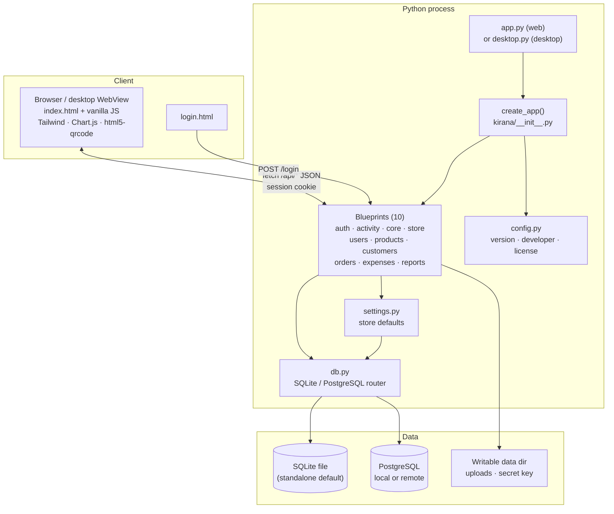
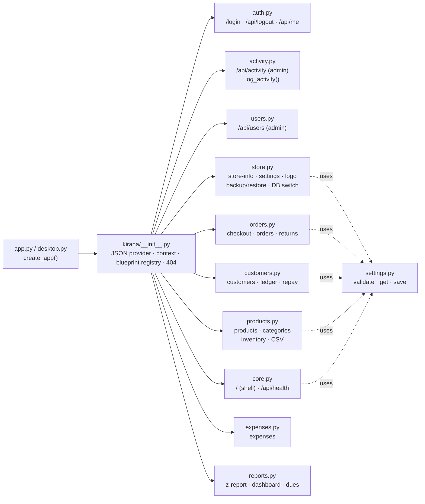
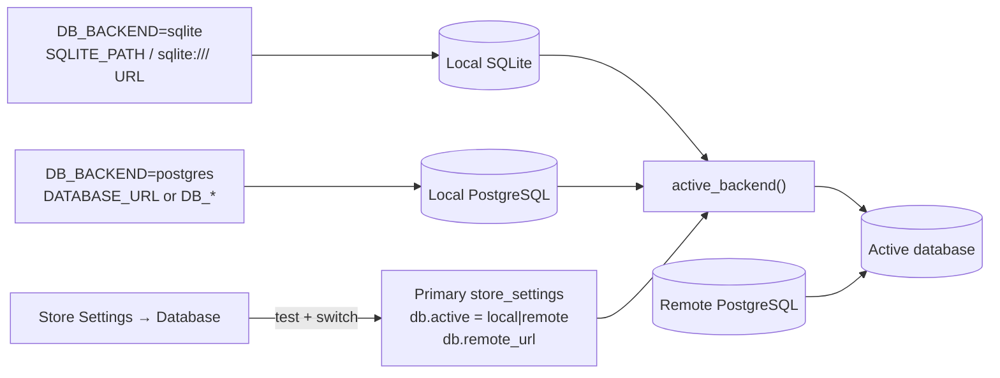
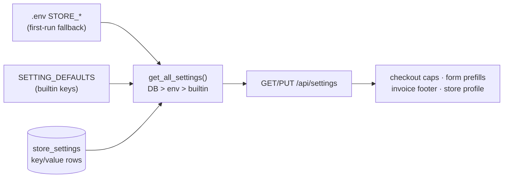
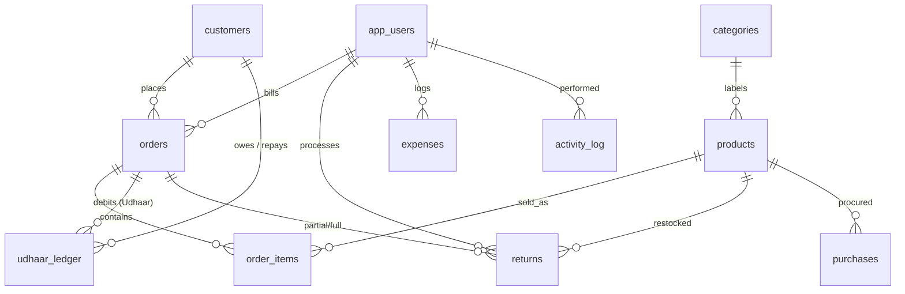

# KiranaPro — Architecture

**Version:** `APP_VERSION` (default `1.0.0`) · **License:** GPL-3.0 ·
**Repository:** https://github.com/vipulverulkar/Indian-Kirana-Store

## 1. System overview



- **Frontend:** server-rendered shell (`GET /` injects store name/location/logo
  and version/credits via Jinja), then a vanilla-JS SPA — sections toggled
  client-side, all data via `fetch` to `/api/*`. No build step; CDN libs
  (Tailwind, Chart.js, html5-qrcode).
- **Backend:** Flask 3 app factory (`kirana/__init__.py`), one blueprint module
  per domain, shared `db.py` (SQLite compatibility layer or psycopg2 +
  `RealDictCursor`), and `utils.py` (validation, pagination, money formatting).
- **Storage:** standalone mode uses one SQLite file; PostgreSQL mode uses
  `DATABASE_URL` or `DB_*` vars. Runtime Local/Remote selection can point at a
  second PostgreSQL database without restarting.
- **Writable data:** SQLite DB, uploaded logo and the desktop secret key live in
  the project folder in source runs, or a per-user data directory in packaged
  builds (`KIRANA_DATA_DIR` overrides). Read-only assets (`templates/`,
  `static/`, `*.sql`) live in `BASE_DIR`/`RESOURCE_DIR`.
- **Delivery:** `app.py` (Flask/Werkzeug), gunicorn in Docker, or
  `desktop.py` packaged as a one-file PyInstaller executable.

## 2. Backend modules



| Module | Routes | Guard |
|---|---|---|
| `auth.py` | `GET/POST /login`, `POST /api/logout`, `GET /api/me` | session cookie, Werkzeug hash |
| `activity.py` | `GET /api/activity` | admin; write paths call `log_activity()` (best-effort, never raises) |
| `users.py` | `GET/POST /api/users`, `PUT/DELETE /api/users/<id>` | admin; no self-demote/self-delete, last admin kept, unique username, min 6-char password |
| `core.py` | `GET /`, `GET /api/health` | login (shell), open (health) |
| `config.py` | — | app name/version/license/developer metadata from env |
| `store.py` | `/api/store-info`, `/api/settings`, `/api/store-logo`, `/api/backup`, `/api/restore`, `/api/settings/database*`, `/uploads/<file>` | login; writes/backup/restore/database admin |
| `products.py` | `/api/products*`, `/api/categories*`, `/api/inventory/*`, CSV export/import | read: login (`cost_price` stripped for staff); writes/export/vendors/low-stock: admin |
| `customers.py` | `/api/customers*`, `/api/repayment` | login; limit-change + delete: admin |
| `orders.py` | `POST /api/checkout`, `/api/orders*`, `/api/orders/<id>/return` | login (any role can bill/return) |
| `expenses.py` | `/api/expenses*` | admin |
| `reports.py` | `/api/reports/z-report`, `/api/reports/dues`, `/api/dashboard/stats` | admin |

## 3. Database backends

### 3.1 Selection



Selection rules in `db.py`:

- `DB_BACKEND=sqlite` → local SQLite.
- `DB_BACKEND=postgres` → local PostgreSQL.
- No DB configuration at all → SQLite (`DATA_DIR/kirana.db`) so a fresh
  checkout launches standalone.
- `SQLITE_PATH` or `DATABASE_URL=sqlite:///…` selects/overrides the SQLite file.
- PostgreSQL accepts `DATABASE_URL` (preferred) or split
  `DB_NAME/DB_USER/DB_PASSWORD/DB_HOST/DB_PORT`; `DB_SSLMODE=require` is
  enforced when set.
- Remote databases are always PostgreSQL. The `db.active` / `db.remote_url`
  pointer lives in the **primary** database, read through an unrouted
  connection with a 30s TTL cache. A dead remote never blocks switching back,
  and there is no silent fallback.

### 3.2 SQLite compatibility layer

The application SQL is written in the PostgreSQL dialect. `db.py` translates
the small subset used by KiranaPro:

- `%s` placeholders → `?`
- `ILIKE` → `LIKE`; `FOR UPDATE` removed
- `CURRENT_DATE`, `INTERVAL`, `to_char`, `EXTRACT`, `NOW()`
- `::date` / `::int` / other casts
- `GREATEST` / `LEAST` → `MAX` / `MIN`
- `public.` schema qualifiers and `TRUNCATE … CASCADE` (backup restores)

Connections enable foreign keys, `busy_timeout`, WAL + `synchronous=NORMAL`.
Integrity errors are normalised to `DuplicateKeyError` / `ForeignKeyError` so
route handlers behave the same on both backends. Normal writes check foreign
keys immediately; only restore paths call `begin()`, which sets
`PRAGMA defer_foreign_keys=ON` before `BEGIN` so child/parent load order is
tolerant until commit.

Schema bootstrap:

- `init_db_sqlite.sql` creates the standalone schema/indexes.
- Product catalog seeds are reused from `init_db.sql` (single source of truth).
- Default `admin`/`staff` logins are created only when `app_users` is empty;
  `python seed.py` is optional and adds demo customers/categories.

### 3.3 Backup / restore

- PostgreSQL uses `pg_dump` / `psql` (`--column-inserts`, data-only) and `COPY`
  for CSV-zip backups.
- SQLite uses an internal SQL dump and the Python `csv` module — no external
  binaries required.
- Backups never contain password hashes. SQL backups omit `app_users` entirely;
  CSV backups include a credential-free `app_users.csv` for reference only.
  Activity log and database-pointer rows are excluded.
- CSV restore uses `PRAGMA table_info` for SQLite and `information_schema` for
  PostgreSQL; login accounts are not restored; serial sequences are reset after
  a PostgreSQL restore.
- The target install must already have matching login accounts/user IDs,
  because business rows reference `app_users`.

## 4. Key flows

### 4.1 Checkout

```mermaid
sequenceDiagram
    participant JS as Billing JS
    participant ORD as orders.py /api/checkout
    participant SET as settings.py
    participant DB as Active database
    JS->>ORD: POST {items, customer_id?, payment_mode, discount_pct, redeem_points}
    ORD->>SET: max_discount_pct, redeem_cap_pct, earn_per_rs
    ORD->>DB: BEGIN · lock products
    Note over ORD,DB: per item: subtotal, CGST/SGST,<br/>profit = sell − cost; stock check
    ORD->>DB: lock/validate customer<br/>points ≤ balance, ≤ cap%<br/>Udhaar: balance + bill ≤ limit?
    ORD->>DB: INSERT orders → order_items<br/>UPDATE stock<br/>Udhaar ledger Debit + balance<br/>loyalty − used + earned
    ORD->>DB: COMMIT
    ORD->>JS: {order_id, final_amount, discount, redeemed}
```

Discount is applied on (subtotal + GST) before loyalty redemption. Returns
reuse the order and prorate refunds by `paid ÷ gross`.

### 4.2 Settings



### 4.3 Auth

`POST /login` (JSON or form) → Werkzeug `check_password_hash` → Flask
`session{user_id, username, role}` (HttpOnly, SameSite=Lax, Secure via
`COOKIE_SECURE`). `login_required` returns 401 JSON for `/api/*`, redirect for
pages; `admin_required` adds 403 for non-admins.

### 4.4 Runtime database switch

- Activating remote: URL validation → `test_db_url()` (5s timeout) → apply
  `init_db.sql` → upsert `app_users` primary→remote (explicit `user_id`s so
  sessions and FKs survive) → refuse when zero admins remain.
- The remote URL is a secret: accepted on PUT/test, stored server-side, never
  returned (APIs expose host/dbname only). `GET /api/health` reports the active
  target and app version.
- Switching never moves business data; each database keeps its own records.

## 5. Database schema



Tables: `app_users`, `customers`, `products`, `orders`, `order_items`,
`udhaar_ledger`, `returns`, `expenses`, `categories`, `store_settings`,
`purchases`, `activity_log`; internal `schema_meta` records catalog bootstrap.
`products.category` stores the category name (no FK), while `categories` keeps
the canonical dropdown list.

- PostgreSQL: `init_db.sql` (fresh) then `migrate_*.sql` for upgrades.
- SQLite: `init_db_sqlite.sql` uses `INTEGER PRIMARY KEY AUTOINCREMENT`, TEXT
  timestamps and the same foreign-key relationships/checks.
- `seed.py` adds admin/staff users, demo customers and base categories; it is
  idempotent. `store_settings` also holds the DB-selection pointer.

## 6. Frontend structure (`templates/index.html`)

- **Sidebar:** store branding (name/location/address/phone + `vAPP_VERSION`),
  section buttons (Dashboard, Billing, Udhaar, Inventory, Master Data, Orders,
  Expenses, Reports, Users, Activity — admin items auto-hide for staff), user
  chip, Store Settings + Logout, and a credits footer (version · GPL-3.0 ·
  developer · location · contact).
- **Sections:** dashboard, billing, udhaar, inventory, master, orders,
  expenses, reports, users, activity — `showSection()` gates staff to
  billing/udhaar/orders/inventory.
- **Modals:** scanner, product, category, store-settings (Store, Billing,
  Loyalty & Udhaar, Inventory, Database), customer, user, order/invoice,
  labels, purchases, stock-in.
- **Database tab:** Local vs Remote radio cards. The remote URL/test controls
  appear only when **Remote** is selected; local mode stays uncluttered.
- **State:** `STORE`, `SETTINGS`, `cart`, `PG` (per-table pagination, sizes
  15/25/50/100 in `localStorage`), `REP` (report period); Chart.js instances
  for weekly / payment-mix / report trend.
- **Conventions:** `fmt` (₹), `esc` (HTML), `jsq` (inline-JS strings),
  `pagerHTML`, `showToast`; invoice print via hidden `#invoice-print`.

## 7. Configuration & operations

- **App metadata:** `APP_VERSION` (default `1.0.0`), `APP_LICENSE` (default
  `GPL-3.0`), `DEVELOPER_NAME`, `DEVELOPER_CONTACT`, `DEVELOPER_LOCATION`.
  Exposed on the login page, sidebar, `/api/health` and `/api/meta`.
- **Database:** `DB_BACKEND`, `SQLITE_PATH`, `DATABASE_URL`, `DB_*`,
  `DB_SSLMODE`; runtime Local/Remote selection in `store_settings`.
- **Runtime:** `SECRET_KEY`, `FLASK_DEBUG`, `PORT`/`KIRANA_PORT`,
  `COOKIE_SECURE`, `KIRANA_DATA_DIR`.
- **Store defaults:** `STORE_*` values only seed first-run blanks; Settings owns
  them afterwards.
- **Standalone:** `python app.py`; SQLite auto-created/seeded; health at
  `GET /api/health`.
- **Desktop:** `desktop.py` binds `127.0.0.1`, picks a free port, opens a
  pywebview window or the default browser, and stores data in the per-user data
  dir. Build with `kirana.spec` + `build_desktop.sh`/`.bat`. PyInstaller is not
  a cross-compiler.
- **PostgreSQL:** apply `init_db.sql`, run `seed.py`, then `app.py`/gunicorn.
- **Docker:** `docker-compose.yml` is PostgreSQL-only; SQLite users should use
  standalone/desktop.
- **Scaling:** stateless app; logo files use a shared volume in Docker. One DB
  connection per request (no pool).
- **License:** GPL-3.0; see [`../LICENSE`](../LICENSE).
